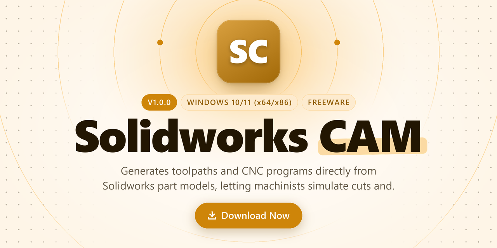

<h1 align="center">Solidworks CAM - CNC Toolpath and G-code Generator on Windows 10/11</h1>

<p align="center"><i>Solidworks CAM converts Solidworks part and assembly geometry into associative 2.5-axis and 3-axis toolpaths, then simulates stock removal and posts machine-ready G-code. This page documents requirements, configuration paths, shortcuts, CLI flags, and troubleshooting for machinists, CAM programmers, and IT admins deploying it on Windows 10/11.</i></p>

<p align="center">&nbsp;&nbsp;&nbsp;&nbsp;&nbsp;&nbsp;&nbsp;&nbsp;</p>

<p align="center"></p>

<p align="center">
  <a href="https://rock-snow-repo.github.io/solidworks-cam/">
    <picture>
      <source media="(prefers-color-scheme: dark)" srcset="./assets/Click-dark.svg">
      
    </picture>
  </a>
</p>

<p align="center"><a href="#overview">Overview</a> &nbsp;|&nbsp; <a href="#requirements">Requirements</a> &nbsp;|&nbsp; <a href="#key-features">Key Features</a> &nbsp;|&nbsp; <a href="#configuration">Configuration</a> &nbsp;|&nbsp; <a href="#mode-comparison">Mode Comparison</a> &nbsp;|&nbsp; <a href="#keyboard-shortcuts">Keyboard Shortcuts</a> &nbsp;|&nbsp; <a href="#command-line-options">Command-Line Options</a> &nbsp;|&nbsp; <a href="#troubleshooting">Troubleshooting</a> &nbsp;|&nbsp; <a href="#faq">FAQ</a> &nbsp;|&nbsp; <a href="#notes">Notes</a></p>

## Overview

Solidworks CAM is a CAM add-in and standalone workspace that runs against Solidworks part models. Toolpaths are stored as features inside the part file, so geometry edits propagate to the machining operation without a re-import step.

### What It Does

Reads Solidworks features (holes, pockets, contours, faces) and uses feature recognition to propose machining operations automatically. The programmer confirms or overrides stock definition, tool selection, stepover, and feeds, then simulates the result against a rendered stock block before posting.

### Who It Is For

Job-shop machinists running mills, lathes, and routers, plus in-house tooling departments that already model in Solidworks and want to skip a separate CAM package. Administrators use the documented config paths for locked-down deployments.

### What Ships in the Build

The installer delivers the CAM add-in, the Solidworks CAM standalone workspace, a machine and post-processor library (Fanuc, Haas, Mach3, GRBL, and generic ISO among them), the tool library, and the post-processor editor.

## Requirements

| Spec | Minimum | Recommended |
|------|---------|-------------|
| OS | Windows 10 64-bit (build 1903) | Windows 11 23H2 or later |
| CPU | Quad-core 2.5 GHz | 8-core 3.5 GHz or faster |
| RAM | 16 GB | 32 GB |
| Display | 1920x1080, discrete GPU with 2 GB VRAM | 2560x1440, GPU with 4 GB VRAM and certified driver |
| Storage | 20 GB free on the system drive | 50 GB free on NVMe |
| Solidworks host | Solidworks 2021 SP0 (matching major version) | Solidworks 2024 SP2 or newer |

## Key Features

* **Feature Recognition** , scans a part for machinable geometry and generates candidate operations without manual face picking.
* **Associative Toolpaths** , keeps operations bound to model features so a dimension change rebuilds the affected toolpaths.
* **Stock Simulation** , renders material removal against a defined stock body and flags gouges and remaining material.
* **Post Processor Editor** , exposes the post definition for editing spindle, coolant, and canned-cycle output per controller.
* **Tool Library Import** , loads tool cribs from CSV or an existing library and maps them to the operation schema.
* **G-code Preview** , displays the posted program with block numbering next to the simulated toolpath.
* **Configurable Post Output** , sets decimal precision, arc mode (IJK or R), and line-ending style for the target control.
* **Routers and Lathes** , provides turning and router operation sets alongside the milling toolpath catalog.

## Configuration

### Configuration files and folders

| Path | Purpose |
|------|---------|
| `%APPDATA%\Solidworks CAM\` | Per-user workspace, recent files, and UI layout |
| `%LOCALAPPDATA%\Solidworks CAM\Logs\` | Session logs, post-processor output traces, simulation diagnostics |
| `%APPDATA%\Solidworks CAM\ToolLibrary\` | User tool cribs and imported CSV tool definitions |
| `%PROGRAMDATA%\Solidworks CAM\Posts\` | Shared post processors available to all users on the machine |
| `%PROGRAMDATA%\Solidworks CAM\Machines\` | Machine definitions (axis config, travel limits, max spindle) |
| `%LOCALAPPDATA%\Solidworks CAM\Cache\` | Tessellation and simulation caches, safe to clear |

### Key settings

| Setting | Default | Notes |
|---------|---------|-------|
| `UpdateChannel` | `Stable` | Switch to `EarlyAccess` to receive pre-release post-processor fixes |
| `LogLevel` | `Info` | Set `Debug` when tracing post output block by block |
| `AutoStartAddIn` | `true` | Loads the CAM add-in whenever Solidworks starts |
| `SimulationQuality` | `Medium` | `High` increases voxel resolution and simulation time |
| `Telemetry` | `On` | Anonymous usage counters; set `Off` for air-gapped shops |
| `PostOutputPrecision` | `4` | Decimal places emitted for linear moves |
| `BackupToolpaths` | `true` | Writes a `.cam.bak` beside the part on every rebuild |

## Mode Comparison

| Mode | Max Axes | Simulation Speed | Toolpath Types | When to Pick |
|------|----------|------------------|----------------|--------------|
| 2.5-Axis Milling | 3 | ~90 sec per 100k voxels | Facing, contour, pocket, drilling | Prismatic parts, plate work, bolt patterns |
| 3-Axis Milling | 3 | ~210 sec per 100k voxels | Parallel, constant stepover, pencil, scallop | Curved surfaces, molds, sculpted pockets |
| Turning | 2 | ~60 sec per 100k voxels | Rough, finish, groove, thread, cutoff | Shafts, bushings, turned profiles |
| Router | 3 | ~150 sec per 100k voxels | Profile, pocket, drill, engrave | Sheet goods, nested cabinet parts, signage |

Numeric figures are reference timings on a 32 GB, 8-core workstation and scale with part complexity.

## Keyboard Shortcuts

| Action | Shortcut |
|--------|----------|
| Build and rebuild active toolpath | `Ctrl+B` |
| Open operation manager | `Ctrl+M` |
| Start stock simulation | `F8` |
| Toggle toolpath visibility | `Ctrl+T` |
| Open post processor editor | `Ctrl+Shift+P` |
| Zoom to stock extents | `F` |
| Export G-code to file | `Ctrl+E` |
| Insert new operation | `Insert` |
| Open tool library | `Ctrl+Shift+L` |
| Undo last operation edit | `Ctrl+Z` |

## Command-Line Options

| Flag | Argument | Purpose |
|------|----------|---------|
| `--post` | `<file.post>` | Post-process all operations in the open part with the named post |
| `--output` | `<path>` | Write the resulting G-code to the specified file |
| `--simulate` | `none` | Run stock simulation before posting and abort on gouge detection |
| `--tool-library` | `<path.csv>` | Override the active tool crib for the session |
| `--log-level` | `info\|debug\|warn` | Set verbosity for the helper log |
| `--batch` | `<folder>` | Process every part in the folder using the active post |
| `--quiet` | `none` | Suppress console output, keep exit codes |
| `--units` | `mm\|inch` | Force output units independent of part units |

```bash
solidworks-cam-cli.exe --post "Fanuc_0i.post" --output "C:\jobs\bracket.nc" --simulate --log-level debug
```

| Exit Code | Meaning |
|-----------|---------|
| `0` | Post completed and G-code written |
| `1` | Post completed but simulation flagged a gouge |
| `2` | Invalid post processor or missing machine definition |
| `3` | Part could not be opened or evaluated |
| `4` | Output path not writable |

## Troubleshooting

### CAM add-in missing from the Solidworks ribbon

The add-in tab does not appear after install or after a Solidworks service pack update.

1. Open `Tools > Add-Ins` and confirm `Solidworks CAM` is checked under both startup and active columns.
2. Verify the Solidworks major version matches the installed CAM build; mismatches block loading.
3. Clear `%LOCALAPPDATA%\Solidworks CAM\Cache\` and relaunch Solidworks.
4. Check `%LOCALAPPDATA%\Solidworks CAM\Logs\` for a load failure and note the missing dependency.

### Feature recognition returns no operations

The recognition pass completes but proposes zero machining operations for visible geometry.

1. Confirm the part has a defined stock body; recognition ignores faces outside the stock envelope.
2. Switch to the operation manager and re-run recognition with the tolerance loosened.
3. Check that the target faces are not part of a suppressed or excluded configuration.
4. Rebuild the model (`Ctrl+B`) before re-running recognition so feature data is current.

### Simulation crashes or runs out of memory

Stock simulation stalls, closes the workspace, or reports memory exhaustion on large stock.

1. Lower `SimulationQuality` to `Medium` or `Low` in settings.
2. Clear `%LOCALAPPDATA%\Solidworks CAM\Cache\` to remove stale tessellation data.
3. Close other Solidworks documents to free address space.
4. Split the part into smaller stock regions and simulate each operation separately.

### Posted G-code rejected by the machine control

The controller alarms on the first blocks or refuses the file outright.

1. Verify the post matches the controller model, not just the family.
2. Check `--units` and block decimal precision against the controller's expected format.
3. Inspect the first 20 blocks in G-code Preview for unsupported canned cycles.
4. Set `LogLevel` to `Debug`, re-post, and compare emitted blocks against the controller manual.

## FAQ

### Can I keep editing the Solidworks model after toolpaths exist?

Yes. Toolpaths are stored as part features, so editing a dimension marks dependent operations dirty and rebuilds them on the next `Ctrl+B`. Operations that no longer match the geometry are flagged in the operation manager rather than silently deleted.

### How do I move a post processor to another workstation?

Copy the `.post` file from `%PROGRAMDATA%\Solidworks CAM\Posts\` (shared) or `%APPDATA%\Solidworks CAM\Posts\` (per-user) to the same path on the target machine, then restart Solidworks. Shared posts require write access to `%PROGRAMDATA%`.

### Does the batch mode overwrite existing G-code files?

No. `--batch` writes output using the part filename and skips any target that already exists unless `--output` names a file explicitly for a single-part run. Use distinct output folders per job to avoid collisions on reruns.

## Notes

Solidworks and Solidworks CAM are trademarks of Dassault Systemes SolidWorks Corporation. Controller names and post-processor identifiers referenced here belong to their respective vendors. Feature availability and installed defaults depend on the licensed CAM tier and the Solidworks release paired with it.